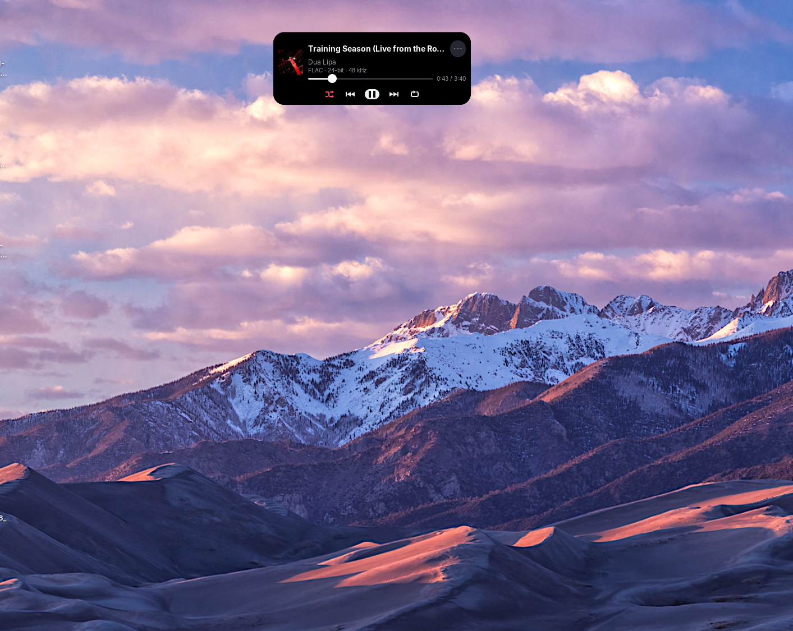
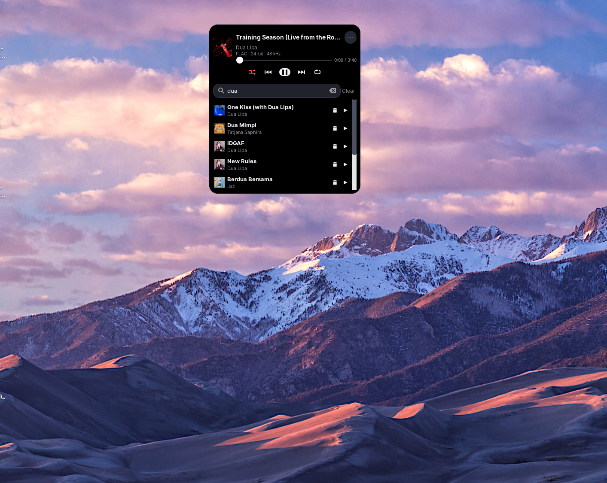
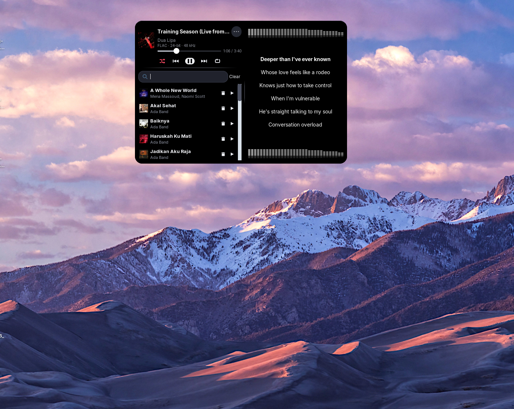
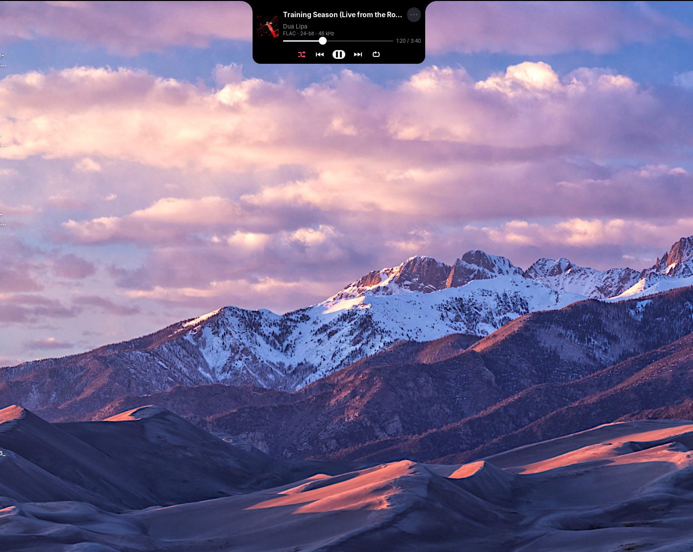
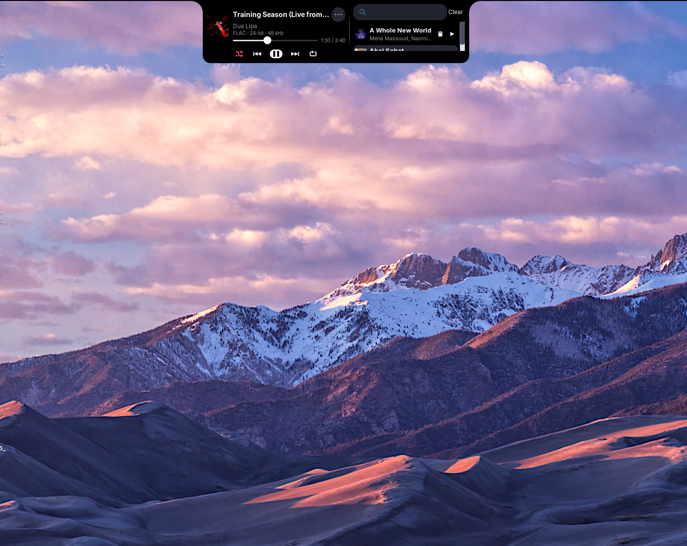
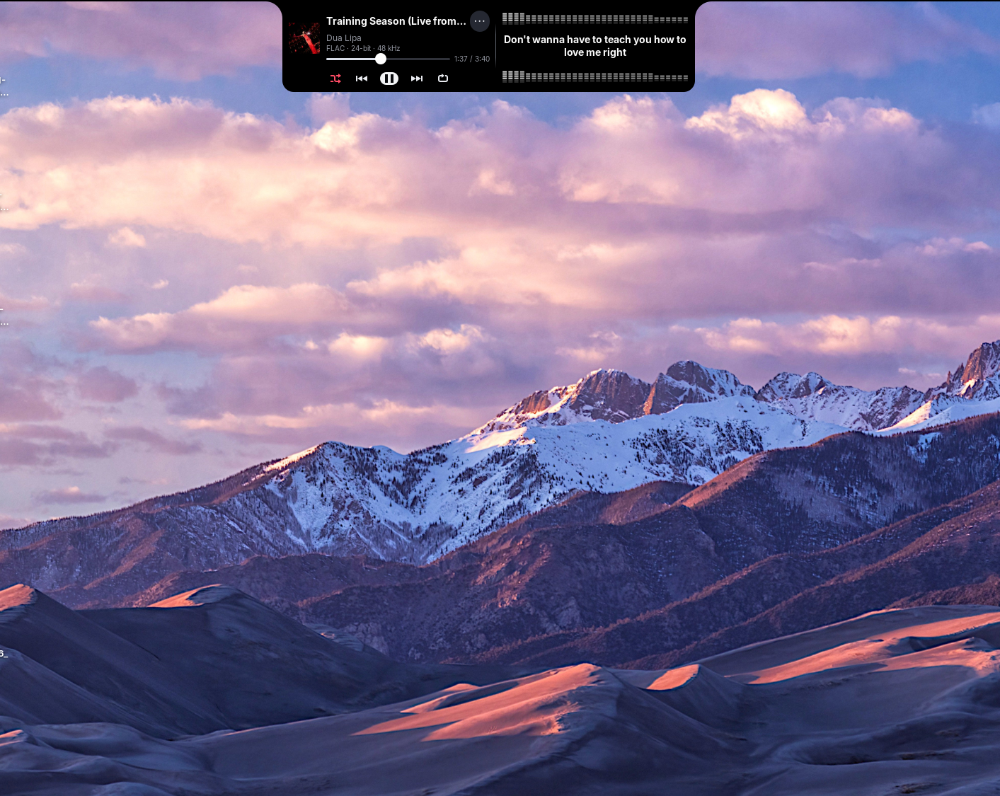

<p align="center">
  
</p>

<h1 align="center">Notch Music</h1>
<p align="center">Pemutar musik lokal dengan Dynamic Island, notch, lirik tersinkron, dan visualizer audio.</p>

Notch Music adalah aplikasi desktop dengan pemutar ringkas, lirik tersinkron, dan panel antrean yang menyatu. Dibuat dengan Python, GTK 3, dan GStreamer.

## Unduh dan jalankan

Pilih paket di [GitHub Releases](https://github.com/irvanvir12/notch-music/releases/latest):

| OS | Paket | Cara menjalankan |
| --- | --- | --- |
| Ubuntu / Zorin / Linux x86_64 | `Notch-Music-x86_64.AppImage` | Beri izin executable lalu jalankan |
| CachyOS / Arch x86_64 | `notch-music-0.5.0-1-x86_64.pkg.tar.zst` | Pasang melalui `pacman -U` |
| Windows 10/11 x64 | `Notch-Music-Windows-x64.zip` | Ekstrak seluruh ZIP lalu buka `Notch-Music.exe` |

Contoh untuk AppImage:

Unduh **Notch-Music-x86_64.AppImage** dari [GitHub Releases](https://github.com/irvanvir12/notch-music/releases/latest), lalu:

```bash
chmod +x Notch-Music-x86_64.AppImage
./Notch-Music-x86_64.AppImage
```

Target paket: **Linux x86_64 dengan glibc ≥ 2.39**, termasuk Zorin OS 18 / Ubuntu 24.04 dan CachyOS/Arch yang diperbarui. Python, GTK, GStreamer, dan codec utama disertakan. AppImage dapat dipindahkan ke folder lain tanpa membawa source proyek.

Jika FUSE tidak tersedia:

```bash
./Notch-Music-x86_64.AppImage --appimage-extract-and-run
```

## Ikon dan menu aplikasi Linux

Logo sudah disertakan di dalam AppImage. Untuk mendaftarkannya pada menu aplikasi dan memasang ikon khusus file di GNOME/Zorin, jalankan dari source:

```bash
/usr/bin/python3 packaging/install_desktop.py /path/ke/Notch-Music-x86_64.AppImage
```

Installer hanya bekerja pada akun pengguna: memasang ikon dalam beberapa ukuran ke `~/.local/share/icons`, menambahkan launcher ke `~/.local/share/applications`, dan mencoba mengatur ikon file melalui metadata GIO. Tidak membuka aplikasi atau mengubah asosiasi audio default. Jika AppImage dipindahkan, jalankan installer lagi dengan lokasi barunya. Ikon khusus file bergantung pada dukungan file manager; refresh folder jika ikon lama masih terlihat.

## Preview

Screenshot aplikasi dari desktop pengguna; klik gambar untuk melihat ukuran penuh.



| 2. Queue di bawah player | 3. Queue dan lirik adaptif |
| --- | --- |
|  |  |

| 4. Menempel sebagai notch | 5. Notch dengan queue | 6. Notch dengan lirik |
| --- | --- | --- |
|  |  |  |

## Fitur

- **Dynamic Island atau notch:** mulai mengambang, bisa digeser; seret ke tepi atas untuk menempel dengan animasi dan lengkungan yang menyatu. Tarik turun untuk mengambang kembali.
- **Musik lokal:** MP3, FLAC, WAV, OGG, M4A dan format lain yang didukung codec GStreamer. Cover, judul/artis, serta lirik embedded FLAC dibaca otomatis; file `.lrc`/`.txt` pendamping didukung.
- **Info audio:** format, bit depth sumber dan sample rate, misalnya `FLAC · 24-bit · 48 kHz`. MP3 menampilkan bitrate jika tersedia.
- **Kontrol ringkas:** Shuffle · Prev · Play/Pause · Next · Repeat. Repeat mati/satu/semua; volume awal **30%**, mute dengan pemulihan volume sebelumnya.
- **Playlist lokal:** Create/Load, tambah lewat ＋ atau drag-drop, save lewat disket ke `.notchplaylist`; nama mengikuti file dan lagu yang hilang dilaporkan beserta direktori asal.
- **Queue menyatu:** pencarian nama file/judul/artis, cover kecil, tombol play, hapus per lagu, serta Clear. File asli tetap tersimpan.
- **Lirik adaptif:** satu kalimat di mode ringkas. Saat mengambang dengan queue aktif, lirik memanjang di kanan; beberapa baris mengikuti timestamp dan baris yang lewat menghilang.
- **Visualizer audio:** batang spektrum bersegmen dan pantulan di atas/bawah lirik, mengikuti musik serta warna tema; mereda saat pause/mute.
- **Dark, Light, Blur:** warna teks kontras mengikuti tema; Blur transparan, efek kabur bergantung compositor. Pilihan tema tersimpan otomatis.
- **Menu ⋯:** Browse, Playlist, Queue, Volume, Lirik (On/Off), Tema, Minimize saat mengambang, dan Close. Menu tema tetap terbuka saat memilih.

## Minimize dan sembunyikan notch

Saat mengambang, **⋯ → Minimize** berada sebelum Close. Musik tetap berjalan; buka kembali lewat taskbar. Pada Wayland layer-shell, jendela taskbar pemulihan menyediakan tombol **Kembalikan player**.

Saat menempel ke atas, klik **segitiga di tengah bawah notch** hingga mengarah **ke atas** untuk mengaktifkan auto-hide. Player bergeser ke atas, menyisakan tab kecil. Arahkan pointer ke tepi atas di posisi notch untuk membukanya sementara; saat pointer keluar, player langsung bergeser menutup lagi. Hover tidak mengubah mode auto-hide. Saat terbuka, klik segitiga hingga mengarah **ke bawah** untuk menjadikannya tetap terbuka. Queue, lirik, dan pemutaran tetap dipertahankan.

## Tombol media dan headset Bluetooth / TWS

Notch Music menyediakan **MPRIS** pada session D-Bus Linux. Desktop dapat meneruskan tombol **Play/Pause, Next, Previous, Stop**, volume dan seek dari headset Bluetooth, keyboard multimedia, atau kontrol media sistem. Identitas player tampil sebagai **Notch Music**; layanan memakai `org.mpris.MediaPlayer2.notch_music.instance<PID>` agar beberapa instance tidak berebut nama.

Putar lagu di Notch Music, lalu gunakan tombol headset. Jika ada beberapa player atau browser yang juga aktif, desktop mungkin memilih player lain; hentikan pemutaran lain saat mengecek. Integrasi ini tidak mengubah pairing atau pengaturan Bluetooth.

Pada Windows, player menerima tombol media **Play/Pause, Next, Previous, dan Stop** melalui Win32 `RegisterHotKey`, termasuk saat tidak fokus atau diminimalkan. TWS harus mengirim tombol media Windows; dukungan gesture bergantung pada perangkat dan driver Bluetooth. Volume TWS tetap mengatur volume sistem Windows. Tombol media bersifat global selama player terbuka; tutup player untuk melepasnya ke aplikasi lain. Jika tombol sudah didaftarkan aplikasi lain, player tetap berjalan dan menulis pemberitahuan di terminal. Integrasi ini belum menyediakan metadata atau sesi media SMTC di panel Windows.

## Playlist lokal

Pilih **⋯ → Playlist → Create Playlist** untuk membuka editor kosong yang menyatu dengan player, seperti queue. Tidak perlu mengisi nama saat membuat playlist. Gunakan ikon **＋** untuk menambahkan lagu/folder lewat dialog Browse yang sama, atau seret lagu/folder dari file manager ke player saat editor playlist terbuka. Daftar menyediakan tombol play dan hapus per lagu. Membuat atau mengedit playlist tidak menghentikan musik; menekan play memuat daftar playlist ke antrean pemutaran.

Klik ikon **disket** untuk memilih lokasi simpan dan mengetik nama file pada perangkat Anda; nama file menjadi nama playlist. Nama tersebut tampil di atas daftar setelah disimpan atau di-load. Format **`.notchplaylist`** berisi nama dan direktori asli setiap lagu; file audio tidak disalin. Klik disket lagi untuk menyimpan perubahan ke file yang sama. **⋯ → Playlist → Load Playlist** membuka file chooser dengan filter khusus format tersebut. Lagu yang sudah dipindahkan/dihapus tetap terlihat sebagai **File tidak ditemukan**; menekan play menampilkan direktori asal dan alasan kegagalannya. Lokasi audio harus tetap tersedia pada perangkat tempat playlist diputar.

**⋯ → Queue** kembali ke antrean pemutaran biasa. Editor playlist dan queue memakai panel yang sama; lirik tetap mengikuti aturan floating/notch seperti sebelumnya.

## Menambahkan musik

Klik **⋯ → Browse** untuk membuka dialog pemilih file terpisah. Saat dialog dibuka atau folder diganti, tidak ada file yang otomatis terpilih. Pilih satu lagu, **Ctrl+klik** untuk beberapa lagu, atau **Ctrl+A** untuk seluruh file yang ditampilkan, lalu **Select**.

Untuk mengambil isi folder, buka folder lalu klik **Select** tanpa memilih file. Lagu dalam subfolder ikut dipindai di latar belakang. Anda juga bisa menyeret file musik ke notch.

Player awal hanya menampilkan kontrol musik yang ringkas. Saat mengambang, **⋯ → Queue** membuka antrean hingga lima lagu di bawah player dengan pencarian di atas. **⋯ → Lirik (Off)** membuka lirik di kanan; keduanya bisa aktif bersamaan. Lirik mengikuti tinggi player + queue dan menampilkan beberapa baris mengikuti timestamp; baris yang sudah lewat menghilang. Saat queue ditutup, lirik kembali satu kalimat setinggi player. Saat menempel menjadi notch, queue dan lirik bergantian di kanan. Klik menu masing-masing lagi untuk menutup panel. Panel melebar seimbang ke kiri dan kanan dari posisi player. Saat menempel di atas, keseluruhan notch tetap di tengah layar; garis tipis di tepi atas mengikuti tema. Menu Queue membuka/menutup panel antrean. Pencarian langsung memfilter nama file, judul, dan artis dari metadata FLAC di seluruh antrean, dengan maksimal 100 hasil ditampilkan sekaligus. Pencarian mengabaikan kapitalisasi dan mendukung beberapa kata dalam urutan berbeda. Tekan Enter untuk memutar hasil pertama. Klik lagu untuk memutarnya atau ikon tempat sampah untuk menghapusnya dari antrean.

| Kontrol | Fungsi |
| --- | --- |
| Space | Play/pause saat tidak mengetik pada pencarian |
| Esc | Lipat panel; jika panel sudah tertutup, keluar dari aplikasi |
| ⋯ → Volume | Slider volume (awal 30%) dan speaker mute/unmute |
| ⋯ → Lirik (On) / (Off) | Tampilkan/sembunyikan lirik |
| ⋯ → Tema | Pilih Dark, Light, atau Blur |
| ⋯ → Minimize | Minimalkan player saat mengambang; pulihkan lewat taskbar |
| Segitiga bawah notch | Aktifkan auto-hide; klik lagi untuk tetap terbuka |
| ⋯ → Close | Keluar |

## Jalankan dari source

Perintah di bawah untuk Ubuntu/Zorin. Untuk Windows, lihat bagian Windows.

```bash
git clone git@github.com:irvanvir12/notch-music.git
cd notch-music
sudo apt install python3 python3-gi python3-cairo python3-gi-cairo \
  gir1.2-gtk-3.0 gir1.2-gstreamer-1.0 \
  gstreamer1.0-plugins-base gstreamer1.0-plugins-good gstreamer1.0-libav
./run.sh
# Langsung membuka lagu:
./run.sh ~/Music/lagu.flac
```

## CachyOS / Arch Linux

AppImage juga dapat dipakai di CachyOS x86_64 yang diperbarui. Jika FUSE tidak tersedia, gunakan `--appimage-extract-and-run` seperti di atas.

Pada KDE/Hyprland/Sway Wayland, aplikasi memakai `gtk-layer-shell`. GNOME/Zorin dan sesi X11 memakai X11/XWayland. Player mulai mengambang; seret ke tepi atas untuk menjadi notch. Seluruh GTK, codec audio, metadata, queue, lirik dan visualizer tersedia dari dependensi paket Arch.

Paket native `.pkg.tar.zst` juga tersedia di [Releases](https://github.com/irvanvir12/notch-music/releases/latest):

```bash
sudo pacman -Syu
sudo pacman -U ./notch-music-0.5.0-1-x86_64.pkg.tar.zst
notch-music
```

Paket hasil build lokal kode saat ini ada di `dist/`; paket di Releases dapat berisi versi kode yang lebih lama.

Untuk menjalankan source dengan dependensi native:

```bash
sudo pacman -Syu --needed git python python-gobject python-cairo gtk3 gtk-layer-shell \
  gstreamer gst-plugins-base gst-plugins-good gst-libav adwaita-icon-theme
git clone https://github.com/irvanvir12/notch-music.git
cd notch-music
./run.sh
```

Alternatif paket native yang dikelola pacman (jalankan sebagai pengguna biasa, bukan root):

```bash
sudo pacman -Syu --needed base-devel
./packaging/arch/build-package.sh
```

Skrip membuat arsip dari checkout, menguji, membangun `.pkg.tar.zst`, lalu menawarkan instalasi melalui `makepkg -si`. Paket memasang perintah `notch-music` dan launcher menu aplikasi. Ini paket lokal, belum dipublikasikan ke AUR.

Pada Wayland dengan compositor yang mendukung layer-shell, aplikasi memilih Wayland native dan menempel di sisi atas layar. GNOME/Zorin tetap memakai XWayland. Untuk fallback pada CachyOS Wayland, pasang `xorg-xwayland`. Anda dapat memaksa backend:

```bash
NOTCH_GDK_BACKEND=x11 ./run.sh
NOTCH_GDK_BACKEND=wayland ./run.sh
```

Bila compositor tidak mendukung layer-shell, fallback XWayland dipakai jika tersedia. Dukungan posisi, transparansi, dan panel tetap bergantung pada compositor. CI menguji source, build, dan instalasi paket di container Arch; ini bukan pengujian visual pada desktop CachyOS asli.

## Windows 10/11 x64

Build Windows x64 memakai backend Win32 dengan runtime Python, GTK, dan GStreamer yang ikut dibundel. Paket Windows hanya dimasukkan ke release setelah unit test dan smoke test paket portable berhasil di runner Windows.

### Menjalankan source di Windows

Pasang [MSYS2](https://www.msys2.org/), buka terminal **UCRT64**, lalu:

```bash
pacman -Syu --needed mingw-w64-ucrt-x86_64-python \
  mingw-w64-ucrt-x86_64-python-gobject mingw-w64-ucrt-x86_64-python-cairo \
  mingw-w64-ucrt-x86_64-gtk3 mingw-w64-ucrt-x86_64-gstreamer \
  mingw-w64-ucrt-x86_64-gst-plugins-base mingw-w64-ucrt-x86_64-gst-plugins-good \
  mingw-w64-ucrt-x86_64-gst-libav mingw-w64-ucrt-x86_64-adwaita-icon-theme \
  mingw-w64-ucrt-x86_64-adwaita-icon-theme-legacy
```

Setelah dependensi terpasang, klik dua kali **run-windows.cmd** di folder source. Skrip memakai `C:\msys64\ucrt64`; jika lokasi MSYS2 berbeda, atur variabel `MSYS2_UCRT64`. Tidak perlu menginstal Python dari python.org untuk jalur ini. Metode ini mengikuti [panduan resmi GTK untuk Windows/MSYS2](https://www.gtk.org/docs/installations/windows/).

### Membuat paket portable

Di terminal UCRT64, dari folder source:

```bash
pacman -S --needed mingw-w64-ucrt-x86_64-gcc
/ucrt64/bin/python -m unittest discover -s tests -v
/ucrt64/bin/python packaging/windows/build.py
```

Hasil setelah build dan smoke test berhasil: `dist/Notch-Music-Windows-x64.zip` beserta SHA-256. Ekstrak **seluruh ZIP** dan buka `Notch-Music.exe`; folder `runtime` dan `app` harus tetap bersamanya. Runtime Python, GTK, GStreamer, codec, dan ikon ikut dibundel. Log kesalahan disimpan di `%LOCALAPPDATA%\Notch Music\notch-music.log`.

Workflow [Windows portable build](.github/workflows/windows.yml) dapat dijalankan manual dan dipanggil oleh workflow release. Workflow membangun di Windows, menguji paket dengan lingkungan MSYS2 dibersihkan dari PATH, lalu menyimpan ZIP sebagai **artifact Actions**. Workflow release menyertakannya bersama paket Linux setelah semua build lolos. Pengujian meliputi GTK, audio tanpa keluaran suara, visualizer, lirik, queue, tema, mute, dan tombol media Windows.

## Build dan pengujian

Lihat [panduan packaging](packaging/README.md) untuk membangun AppImage. Folder `dist/`, runtime unduhan, cache, dan konfigurasi lokal diabaikan Git. Binary AppImage didistribusikan melalui aset release.

```bash
/usr/bin/python3 -m unittest discover -s tests -v
./dist/Notch-Music-x86_64.AppImage --appimage-extract-and-run --self-test
```

Workflow [Release](.github/workflows/release.yml) menguji Arch/CachyOS, AppImage dan Windows. Tag `v*` memublikasikan release setelah seluruh job berhasil, dengan checksum SHA-256 untuk setiap jenis paket.

## Catatan desktop dan lirik

Pada GNOME Wayland, aplikasi memakai XWayland untuk posisi atas dan keep-above. Window manager menentukan posisi akhir; panel sistem dapat bertumpuk dengan notch. Area di luar notch tetap meneruskan klik, dan aplikasi tidak mengubah pengaturan panel desktop.

Tema **Blur** bersifat transparan; efek kabur sebenarnya bergantung pada compositor. Lirik tersinkron memerlukan timestamp; lirik tanpa timing menampilkan kalimat awal serta teks penuh pada tooltip. Highlight mengikuti **per baris/kalimat**, bukan per kata. Integrasi Spotify, autostart, dan penyimpanan antrean antar-sesi belum tersedia.

Pengaturan tema disimpan di `$XDG_CONFIG_HOME/notch-music/settings.json` (default `~/.config/notch-music/settings.json`).
